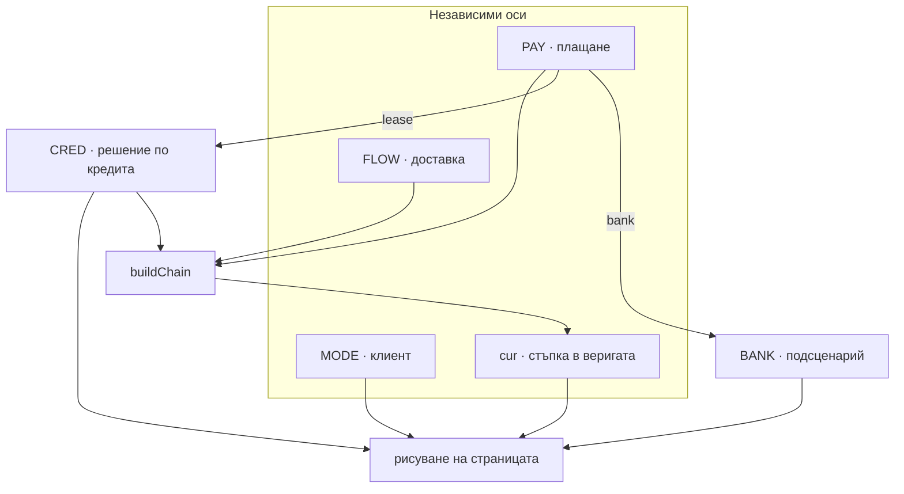

# Архитектура на изборите — `orderdetails.html`

Демо страницата комбинира независими оси на избор. Крайният UI = **клиент × доставка × плащане × (подсценарий) × текуща стъпка**.

Състоянието е само в паметта на страницата — без cookies / `localStorage` / `sessionStorage`.

---

## 1. Оси на избор (демо контроли)



| Ос | Променлива | Стойности | Демо UI |
|---|---|---|---|
| Клиент | `MODE` | `email` · `phone` · `in` | `#srcBtns` |
| Доставка | `FLOW` | `courier` · `store` · `cancelled` | `#flowBtns` |
| Плащане | `PAY` | `cod` · `card` · `bank` · `lease` | `#payBtns` |
| Банков превод | `BANK` | `pending` · `paid` | `#bankBtns` (само при `PAY=bank`) |
| Кредит | `CRED` | `pending` · `approved` · `rejected` | `#credBtns` (само при `PAY=lease`) |
| Стъпка | `cur` | индекс в `chain` | `#demoBtns` + stepper |
| PII | `shown` | `false` · `true` | OTP „Покажи данните“ |

Допълнително (не е в страничната лента): `LEND` — активен кредитор (`ПБ Лични финанси` / `УниКредит`).

---

## 2. Клиент (`MODE`)

Влияе на достъп, gate и регистрация — **не** променя stepper веригата.

| Стойност | Етикет | Ефект |
|---|---|---|
| `email` | поръчка с имейл | има имейл ред; CTA „Създай профил“; линк с срок |
| `phone` | само телефон | без имейл ред; CTA регистрация |
| `in` | логнат профил | badge „Вие сте…“; блок за съществуващ акаунт; безсрочни документи |

При смяна на `MODE` → `shown = false` (данните се маскират отново).

---

## 3. Доставка (`FLOW`) → базова верига

```text
courier:   accepted → sent → delivered
store:     accepted → sent → store_ready → picked
cancelled: accepted → cancelled
```

| Стойност | Етикет | Бележки |
|---|---|---|
| `courier` | куриер | 3 стъпки; track Speedy след `sent` |
| `store` | магазин | 4 стъпки; `sent` = към магазина |
| `cancelled` | отказана | без ship стъпки; `cur` скача на `cancelled` |

---

## 4. Плащане (`PAY`) → вмъкване в веригата

```text
cod / card:  без вмъкване  →  базовата FLOW верига
bank:        insert pay    след accepted
lease:       insert credit след accepted
```

Примери при `FLOW=courier`:

```text
cod/card:  accepted → sent → delivered
bank:      accepted → pay → sent → delivered
lease:     accepted → credit → sent → delivered
```

| Стойност | Етикет | Подсценарии | UI ефекти |
|---|---|---|---|
| `cod` | наложен платеж | — | chip „Плащане при доставка“ |
| `card` | с карта | — | chip „Платено…“ |
| `bank` | банков превод | `BANK` | проформа документ; pay box при очакване |
| `lease` | на изплащане | `CRED` | кредитор в етикета; кредитни текстове |

---

## 5. Подсценарии

### 5.1 Банков превод (`BANK`) — видим само при `PAY=bank`

| Стойност | Етикет | Стъпка `pay` | Pay box | Chip |
|---|---|---|---|---|
| `pending` | очаква плащане | текуща · „Очаква плащане“ | показан | warn |
| `paid` | платено | текуща · „Получено плащане“ | скрит | ok |

И в двата случая бъдещите стъпки (`sent`, `delivered` / store еквиваленти) остават видими като предстоящи.

При избор на `PAY=bank` → `BANK` се нулира на `pending`, `cur` = индекс на `pay`.

### 5.2 Кредит (`CRED`) — видим само при `PAY=lease`

| Стойност | Етикет | Stepper / hero | Верига |
|---|---|---|---|
| `pending` | очаква | „Очаква решение…“ | пълна |
| `approved` | одобрен | „Кредитът е одобрен“ · предстои подпис | пълна |
| `rejected` | отказан | „Кредитът е отказан“ | **без** ship стъпки (`sent`…) |
| `signed` | *(в кода, без бутон в демото)* | „Договорът е подписан“ | пълна |

`#rejBox` (CTA „кандидатствай при друг“) е **винаги скрит**.

---

## 6. Как се сглобява `chain`

```text
1. base = FLOWS[FLOW]
2. ако PAYS[PAY].insert → вмъкни id след insert.after
3. ако FLOW=cancelled ИЛИ (PAY=lease И CRED=rejected)
     → махни NO_SHIP_STEPS (sent, delivered, store_ready, picked)
```

След това `cur` сочи текущата стъпка; `#demoBtns` се генерира от `chain`.

---

## 7. Матрица: какво се вижда според плащане

| | pay box | bankBtns | credBtns | doc проформа | credit step | pay step |
|---|---|---|---|---|---|---|
| cod | — | — | — | — | — | — |
| card | — | — | — | — | — | — |
| bank · pending | ✓ | ✓ | — | ✓ | — | ✓ текуща |
| bank · paid | — | ✓ | — | ✓ | — | ✓ текуща |
| lease · * | — | — | ✓ | — | ✓ | — |

---

## 8. Напречни правила

- **Отказана поръчка** (`FLOW=cancelled`) винаги реже ship стъпките, независимо от плащането.
- **Отказан кредит** реже ship стъпките **само** при `PAY=lease` (не влияе на bank/cod/card).
- **PII** са маскирани по подразбиране; разкриване през SMS OTP; няма персистентност между поселещения.
- Демо лентата (`#demoBtns`) = бърз скок по стъпките на текущата `chain`, не отделна ос.

---

## 9. Карта на файловете

| Файл | Роля |
|---|---|
| `orderdetails.html` | UI + цялата логика на изборите |
| `orderdetails-choices.md` | този документ |

Променливи и `buildChain` / `paint*` са в `<script>` на `orderdetails.html`.
